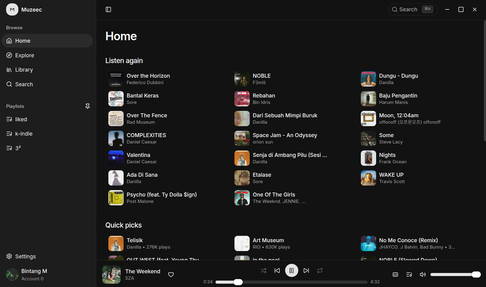

<p align="center">
  <picture>
    <source media="(prefers-color-scheme: dark)" srcset="resources/logo-dark.svg" />
    
  </picture>
</p>

<p align="center">
  <strong>A minimal, modern YouTube Music desktop client.</strong><br />
  Electron · React · TypeScript · Tailwind CSS
</p>

---

Muzeec is an unofficial YouTube Music desktop app built for a fast, clean listening experience. It browses your real YouTube Music library, streams audio directly from YouTube, and keeps account actions such as likes, playlists, and subscriptions in sync.

It is a personal project: small, keyboard-friendly, and designed to stay out of the way.

<p align="center">
  
</p>

## Features

### Listening

- Home, Explore, Library, and Search browsing.
- Album, playlist, and artist pages with play-all and track lists.
- Queue management with drag-to-reorder and keyboard reordering.
- Shuffle, repeat one / repeat all, autoplay radio, and preview of upcoming tracks.
- Seek, volume, mute, and like controls in the player bar.
- Normal and high audio quality settings.
- OS media controls, media keys, and a system tray with playback actions.

### Library and account

- Optional Google sign-in through Google's own window.
- Liked songs, playlists, and library content loaded live from your account.
- Like / unlike songs.
- Create, add to, and delete playlists.
- Playlist sorting by date added (source order) or title, ascending or descending.
- Subscribe and unsubscribe from artists.
- Best-effort playback history reporting to YouTube, with a setting to disable it.

### Lyrics

- Time-synced lyrics from multiple providers, including lrc.red, BiniLyrics, Unison, and YouTube Music.
- Word-level or line-level timing when available.
- Active-line highlighting, click-to-seek, and a ±5 second offset control.
- Configurable provider priority and syllable-timing preference.
- In-memory lyrics caching to avoid repeated requests.

### Desktop experience

- Frameless custom window with native window controls.
- Dark, light, and system themes.
- Command palette for navigation and search.
- Close-to-tray behavior; quit from the tray menu.
- Single-instance app with custom app and tray icons.
- Linux AppImage and Windows NSIS installer builds.

## Tech stack

| Area | Technology |
| --- | --- |
| Desktop shell | Electron |
| Build tooling | electron-vite, Vite |
| UI | React 19, TypeScript, Tailwind CSS v4, shadcn/ui (Base UI) |
| State | Zustand |
| YouTube integration | Custom InnerTube client, `youtubei.js` for signature deciphering |
| Desktop integration | Electron Tray, global shortcuts, Media Session API |
| Packaging | electron-builder |

## Requirements

- Node.js `^20.19.0` or `>=22.12.0`
- npm
- A desktop environment for Electron

## Getting started

From the project root:

```bash
npm install
npm run dev
```

The app starts without signing in. Browsing and playback work anonymously; signing in unlocks your library, likes, playlists, and subscriptions.

To sign in, use **Sign in** in the sidebar or the Settings page. Authentication happens in an isolated Google window, and cookies stay inside the main process.

## Scripts

| Command | Description |
| --- | --- |
| `npm run dev` | Start the app in development mode with hot reload |
| `npm run build` | Type-check and build the main, preload, and renderer bundles |
| `npm start` | Preview the production build |
| `npm run typecheck` | Run TypeScript without emitting files |
| `npm test` | Run the unit tests |
| `npm run dist` | Build the app and create the default installer for the current platform |
| `npm run dist:linux` | Build a Linux AppImage |
| `npm run dist:win` | Build a Windows NSIS installer |

Build artifacts are written to `dist/`.

## Building installers

```bash
# Linux AppImage
npm run dist:linux

# Windows NSIS installer (x64)
npm run dist:win
```

The generated files are:

- `dist/Muzeec-<version>-linux-x86_64.AppImage`
- `dist/Muzeec-<version>-win-x64.exe`

Windows builds can be produced on Linux, but require Wine to be installed. Release builds are currently unsigned, so Windows may show a SmartScreen warning and Linux may require marking the AppImage as executable:

```bash
chmod +x Muzeec-*.AppImage
```

## Keyboard shortcuts

| Shortcut | Action |
| --- | --- |
| `Ctrl/Cmd + K` | Open the command palette |
| `Ctrl/Cmd + B` | Toggle the sidebar |
| Media play/pause, next, previous | Control playback through the system |

Queue items can be reordered with drag and drop or with the arrow keys while focused.

## How it works

Muzeec keeps privileged work out of the renderer:

```
Renderer (React)
    │  typed IPC through preload
    ▼
Main process
    ├─ Google session and cookies
    ├─ InnerTube requests and response parsing
    ├─ audio stream resolution and probing
    ├─ lyrics fetching and caching
    └─ tray, media keys, window and protocol handling
```

- The main process owns the YouTube session and signs authenticated requests with SAPISIDHASH.
- Audio stream URLs are resolved across multiple YouTube clients, deciphered when necessary, and probed before they are handed to the player.
- The renderer plays audio through a single `HTMLAudioElement`. Position updates are throttled to keep React renders cheap.
- The UI is loaded through a custom `app://` protocol with a strict Content Security Policy.
- The renderer runs sandboxed with context isolation enabled and Node integration disabled.

## Project structure

```text
src/
  main/            Electron main process
    youtube/       session, InnerTube, parser, stream resolution, sync, history
    lyrics/        providers, matching, parsing, lookup engine
    storage/       local settings and in-memory cache
    ipc.ts         typed IPC handlers
    protocol.ts    app:// protocol and CSP
    tray.ts        system tray and media keys
    window.ts      main window and Google sign-in window
  preload/         contextBridge API exposed to the renderer
  renderer/        React application
    pages/         Home, Explore, Library, Search, Detail, Artist, Settings
    components/    player bar, track lists, cards, lyrics, command palette, UI primitives
    player/        audio engine, playback controller, sequence handling
    lib/           Zustand stores and helpers
  shared/          shared TypeScript types
resources/         app icons, logos, and tray assets
docs/              architecture and lyrics design documents
test/              unit tests and smoke scripts
```

## Data and privacy

- No telemetry or analytics are sent by Muzeec.
- Google session cookies live in Electron's persistent `persist:youtube` partition and are never exposed to the renderer.
- Local preferences are stored in `settings.json`; sign-in metadata is stored in `auth.json` under Electron's `userData` directory.
- Lyrics are fetched directly from third-party providers on your device. Provider order can be changed in Settings.
- Playback history is only sent to YouTube when **Send playback history** is enabled.
- Signing out clears the app's YouTube session storage and cached account state.

## Documentation

- [`docs/ELECTRON_YOUTUBE_MUSIC.md`](docs/ELECTRON_YOUTUBE_MUSIC.md) — architecture notes for authentication, InnerTube, stream resolution, and playback.
- [`docs/LYRICS_FETCHING_ENGINE.md`](docs/LYRICS_FETCHING_ENGINE.md) — multi-provider lyrics engine design.
- [`PLAN.md`](PLAN.md) — implementation plan and early design decisions.

## Troubleshooting

- **The tray icon or media keys do not work on Linux.** Support depends on the desktop environment and its tray/AppIndicator implementation. Some desktops reserve media keys for the system.
- **An AppImage does not launch.** Make it executable with `chmod +x`, or run it with `--appimage-extract-and-run` if FUSE is unavailable.
- **Playback stops working after a YouTube change.** YouTube frequently changes its client configuration and player scripts. Update dependencies and retry; the stream resolver falls back across multiple clients.
- **The Windows installer triggers SmartScreen.** The build is unsigned. Use the installer you built yourself, or sign releases with your own certificate.

## Disclaimer

Muzeec is an unofficial client and is not affiliated with YouTube, Google, or any lyrics provider. It does not download or redistribute music; audio is streamed from YouTube. Use it with your own account and in accordance with the services' terms.
